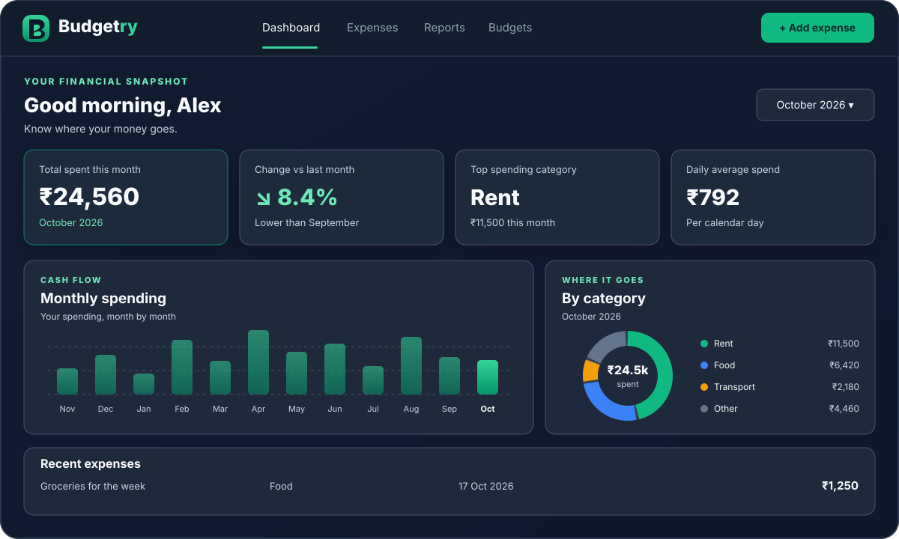
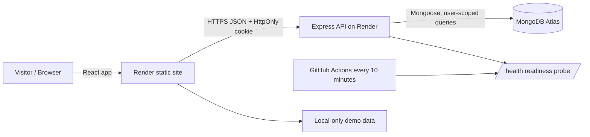

# Budgetry — Know where your money goes.

Budgetry is a responsive, privacy-minded expense tracker built as an interview portfolio project. It helps users record transactions in INR, inspect monthly spending, and organize their budgets.

**Live app:** https://only-sameer-expense-tracker-web.onrender.com  
**API health:** https://only-sameer-expense-tracker-api.onrender.com/health  
**Repository:** https://github.com/Only-Sameer/expense-tracker-mern



Social-share artwork: `client/public/og-image.svg` (1200 × 630).

## Features

- Email/password signup and sign-in; password hashes use bcrypt.
- Optional email verification and one-time password reset through Resend. These require `RESEND_API_KEY` and `EMAIL_FROM` in the server environment; without them, the routes return a clear configuration message and legacy signup/sign-in remains enabled.
- HttpOnly session cookie, origin checks on mutating requests, auth rate limits, server-side Zod validation and user-scoped database queries.
- Monthly summary cards, annual spending bar chart, category breakdown, insights, search, category/date filters, sort, and pagination.
- Add/edit expenses with INR amounts, eight core categories, date, notes (maximum 300 characters), and inline validation.
- CSV and JSON export, CSV import with validation and a preview/confirmation step, and account deletion behind a typed confirmation.
- Category budgets and custom categories. Budget values and custom-category colours are local to the current browser; a category rename updates matching saved expenses and recurring rules.
- Recurring rules stored in MongoDB. When a signed-in user loads the dashboard, the API creates due entries at most once per rule per calendar month.
- Responsive mobile navigation, keyboard shortcuts (`N` to add and `/` to focus search), visible focus styles, reduced-motion support, light/dark themes.
- Anonymous demo mode loads 60 sample expenses across six months in browser memory. Reset it from the demo banner. It is intentionally **not a shared demo account**: demo edits/imports/deletes are not sent to the API and cannot change another visitor's data.

## Technology

- **Frontend:** React, Vite, React Router, Recharts, custom CSS design tokens.
- **Backend:** Node.js, Express, Mongoose, MongoDB Atlas, Zod.
- **Security and operations:** Helmet, CORS, HttpOnly cookies, origin validation, express-rate-limit, hashed expiring auth tokens, GitHub Actions, Render.
- **No Tailwind migration:** The existing custom CSS system was retained to avoid carrying two styling systems and to keep this incremental redesign lower-risk.

## Architecture



## Folder structure

```text
client/
  public/
    _redirects
    favicon.svg
    manifest.webmanifest
    pwa-icon.svg
    og-image.svg                 # 1200 × 630 social-card artwork
    dashboard-preview.svg        # Illustrative landing-page dashboard preview
  src/
    components/
      Header.jsx                 # Header, theme toggle, avatar menu
      BudgetryUI.jsx             # Sidebar, forms, table, budgets, settings, empty states
      Charts.jsx                 # Lazy-loaded Recharts charts
    lib/
      finance.js                 # Currency, date/filter helpers, CSV, demo fixtures
      finance.test.js            # Pure helper tests
    pages/
      Dashboard.jsx
      Auth.jsx
      Recovery.jsx               # Verification and password reset flows
      Legal.jsx
      Admin.jsx
    api.js                       # Bounded safe-request retries
    hooks.js
    styles.css
server/
  src/
    app.js                       # Middleware, /health, routes
    index.js
    config/
    middleware/
    models/
      User.js
      Expense.js
      RecurringExpense.js
      AuthToken.js
    routes/
      auth.js
      expenses.js
      recurring.js
      admin.js
    services/
      mailer.js                  # Optional Resend provider
    validation/
  test/
.github/workflows/
  ci.yml
  keepalive.yml                 # Scheduled /health ping
```

## Run locally

Requires Node.js **20.19+** (or 22.12+) and a reachable MongoDB database.

1. Copy `server/.env.example` to `server/.env`.
2. Set `MONGODB_URI`, `JWT_SECRET` (at least 32 random characters), `CLIENT_ORIGIN=http://localhost:5173`, and local cookie settings (`COOKIE_SECURE=false`, `COOKIE_SAME_SITE=lax`). For production email verification/password reset, also configure `RESEND_API_KEY` and a verified `EMAIL_FROM` sender. Keep the API key in Render environment variables only.
3. From the repository root run:
   ```bash
   npm install
   npm test
   npm run build
   ```
4. In separate terminals start the API and the client:
   ```bash
   npm run dev:server
   npm run dev:client
   ```
5. Open http://localhost:5173. Production uses Render environment variables; never add real credentials to a committed `.env` file.

## Blank-page recovery and asset caching

The HTML shell displays a styled boot state before React starts. If an app script fails to load or startup takes more than 12 seconds, the visitor sees a reload action instead of an empty background. A React error boundary catches synchronous render failures and offers a recovery action without exposing stack traces. Render static-site response headers revalidate `/` and `/index.html` while caching hashed `/assets/*` bundles for a year. The frontend and API service names in `render.yaml` are aligned with the existing Render services; if your Render project is not configured to sync the Blueprint automatically, use the same header rules under the static site’s Settings → Headers.

## Health and Render cold starts

- `GET /health` returns HTTP 200 when MongoDB is connected and HTTP 503 otherwise. `GET /api/health` remains available for compatibility.
- The frontend retries failed safe GET requests after brief delays and displays a wake-up state. Mutating requests are not automatically retried, because a timeout cannot prove whether the server committed the operation.
- The scheduled GitHub Actions workflow requests `/health` every ten minutes. GitHub scheduled jobs can be delayed or suspended due to platform limits; a ping is not an uptime guarantee. For a professional demo, a paid always-on service or separate monitoring provider is more reliable.

For static asset caching, set these in Render Dashboard → Static Site → Headers: `/assets/*` → `Cache-Control: public, max-age=31536000, immutable`; `/index.html` → `Cache-Control: no-cache`. Hashed Vite assets are safe to cache long-term; the entry HTML should be revalidated after deploy.

## Design decisions

1. **Keep the stack, improve its boundaries.** React/Recharts already matched the app; a full CSS-framework rewrite would increase change surface without a clear product benefit.
2. **Keep the demo isolated.** The public demo uses generated client-side records instead of a shared writable account, preventing visitors from changing each other's sample data.
3. **Scope database queries by the authenticated user.** Listing, editing, deletion, exports, account deletion, and recurring rules always include the user identifier on the server.
4. **Use bounded retries.** Only idempotent read requests are retried on transient connectivity failures. A POST is never blindly repeated after a network error.
5. **Separate UI and pure business rules.** Budget thresholds, filters, currency formatting, CSV parsing, and demo data generation live in `client/src/lib/finance.js`, making core behavior easier to test.
6. **Be explicit about local-only settings.** Budget limits and category colours are browser-local; recurring rules and expenses are database-backed.

## Testing

```bash
npm test
npm run build
```

The test suite covers API validation and admin allowlist checks, INR formatting, totals, search/date/category sorting, budget thresholds, CSV quoting/formula injection, and the 60-item demo fixture. CI runs tests and the production build on push and pull request.

## Demo access

No public username/password is provided. Open the live site and choose **Try demo data**; this creates a local read-safe sample workspace, and **Reset demo** restores its 60 sample transactions. Sign-up is required for saved account-backed expense records.

## Interview questions and sample answers

### 1. Why did you choose this architecture?
I used React for an interactive UI, Express for a small JSON API, and MongoDB for flexible expense records. Keeping the frontend and backend separate makes deployment and authorization boundaries clear while still letting me iterate quickly.

### 2. How do you protect one user's expenses from another user?
Authentication middleware verifies the signed session cookie and resolves the user from the database. Every expense query then scopes the operation by both the expense ID and authenticated user ID; the client cannot choose which user's records the API returns.

### 3. How is the demo safe for interviews?
Demo data is generated in the browser and held in component state. Add, edit, import, and delete actions stay local while demo mode is active, so the demo doesn't use a shared writable account or change real database records.

### 4. How do you handle cold starts without creating duplicate expenses?
The API retries safe GET requests a bounded number of times and shows a wake-up state. It does not blindly retry POST/PATCH/DELETE requests. Recurring rules use an atomic month marker so simultaneous requests cannot generate the same rule twice for one month.

### 5. What makes the monthly summary accurate?
The dashboard derives totals from the chosen month, calculates the prior month separately, aggregates category totals, and formats values with the `en-IN` locale. The test suite exercises currency grouping, filters, and budget boundaries.

### 6. How do you prevent invalid or hostile input?
Both client and server validate form data; the server is authoritative. Zod constrains amount/date/note/category fields, MongoDB schema validation adds a second boundary, React escapes rendered text by default, and exported CSV cells guard against spreadsheet formula injection.

### 7. Why use client-side pagination after loading records?
The current UI loads the API's server-paginated pages in bounded batches so monthly charts and cross-page filtering can use the complete personal history. The public API itself still paginates at the database query level. A future scale-up should add aggregated summary endpoints and keep filtering server-side for very large histories.

### 8. What would you do before using this for a real financial product?
I would rotate into a fully managed mail domain and validate deliverability, add security audit logs and monitored backups, move budget limits and category palettes to account-scoped storage, add end-to-end/browser accessibility tests, and commission a security review. This project is a portfolio expense tracker, not a regulated financial service.

## Further improvements

- Add provider health monitoring, resend throttling metrics, and UI feedback for email delivery status.
- Move budgets and custom category palettes into account-scoped database preferences.
- Add E2E tests for signup, CSV preview, recurring generation, undo delete, and account deletion.
- Add scheduled data exports and configurable savings goals.
- Add monitoring for health-check failures, API latency, and MongoDB connection errors.
