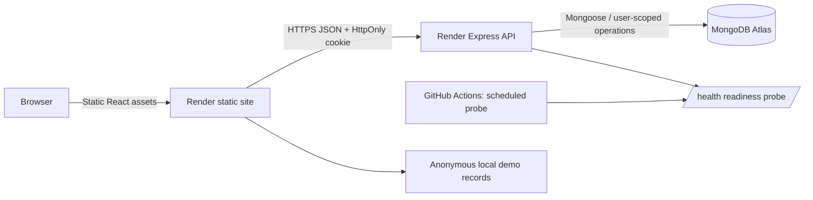

# Budgetry architecture

## Runtime

- Frontend: React 19, Vite, React Router, Recharts and custom CSS design tokens. Render serves the built frontend as a static site.
- Backend: Node.js and Express 5 with Mongoose, MongoDB Atlas and Zod input validation. Render runs the API web service.
- Authentication: bcrypt password hashes, an HS256 session JWT in a Secure/HttpOnly cookie, session-version checks, exact Origin checks for unsafe requests, Helmet, CORS and rate-limited authentication endpoints.
- Email: verification and password-reset links use the optional Resend HTTPS API. These flows become available only when both RESEND_API_KEY and EMAIL_FROM are configured in the API environment.
- Quality checks: GitHub Actions runs the server/client test suites and Vite production build on pushes and pull requests. A separate scheduled workflow requests the API health endpoint every ten minutes.

## Request and data flow

## Relevant code

- server/src/app.js: Helmet, CORS, JSON request limits, cookie parsing, Origin validation, rate limiting, health endpoints and route mounting.
- server/src/routes/auth.js: signup, signin, email verification, password reset, session, data export and account deletion.
- server/src/routes/expenses.js: user-scoped CRUD, query-level pagination/filtering, monthly aggregation, CSV, batched import, and custom-category rename.
- server/src/routes/recurring.js: recurring rules and at-most-once-per-rule/month creation when the signed-in user loads recurring entries.
- server/src/middleware/auth.js: session verification and user resolution.
- client/src/App.jsx: routing, theme, privacy choices and server-wake-up messaging.
- client/src/pages/Dashboard.jsx: dashboard state, expense workflows, filters, pagination, demo mode and export/import actions.
- client/src/components/Header.jsx and BudgetryUI.jsx: header, navigation, forms, empty states, table, budget cards and settings.
- client/src/components/Charts.jsx: lazy-loaded Recharts visualizations.
- client/src/lib/finance.js: INR formatting, calendar date helpers, filtering, CSV, demo fixtures, budget thresholds and totals.

## Trust boundaries and limits

Every authenticated expense operation scopes database reads/writes by req.user._id. The client never supplies a user ID to select whose data is returned. Anonymous demo mode generates records in browser memory and does not write to the API. Budget values and custom-category definitions/colours remain browser-local, while expense records and recurring rules are database-backed.

The dashboard currently loads the query-paginated expense pages in batches to calculate account-wide totals and global client-side filters. This is a reasonable portfolio scale, not the ideal strategy for very large histories. Future scaling should use API summary endpoints, server-side filters and cursor pagination. Recurring expenses are materialized when an authenticated request reads /api/recurring; there is no independent monthly scheduler, so a due entry is created on the next dashboard load after its due date.
